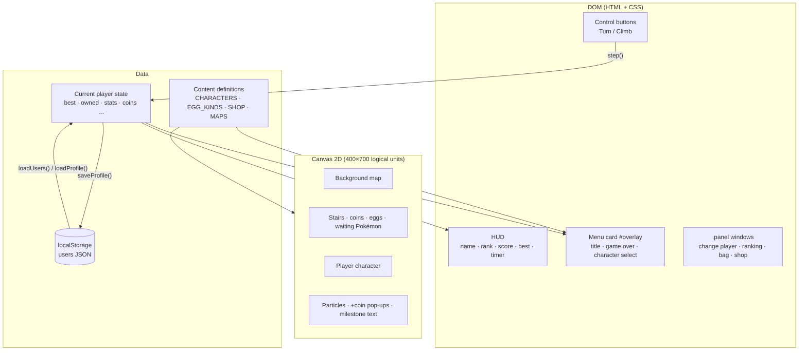
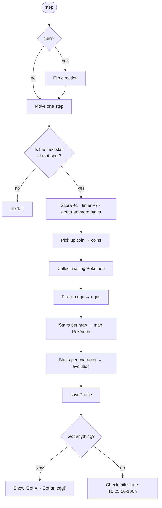

# Architecture

**English** | [한국어](ARCHITECTURE_KR.md)

This document describes how Pokemon Stairs (포캣몬 계단) is built.
For the feature spec see [`spec.md`](spec.md); for working rules see [`CLAUDE.md`](CLAUDE.md) (in Korean).

## 1. Overview

| Item | Details |
|---|---|
| Shape | One file, `index.html` (HTML + CSS + JS, about 7,300 lines) |
| Dependencies | None (no framework, build tool, or external library) |
| Rendering | The game view is Canvas 2D. Menus, windows, and the HUD are DOM |
| Storage | `localStorage` (prefix `pikachuStairs.`), one JSON profile per player |
| Art | No image files. Every character, background, and coin is drawn in Canvas code |
| Sound | Short effects generated with WebAudio oscillators |
| Languages | Korean / English string table (`STRINGS`) |



## 2. Inside the file

The `<script>` in `index.html` is split into sections marked with `// ─── Name ───` comments. The sections run top to bottom, so **an earlier section cannot use a later section's constants at load time** (function declarations are hoisted, so calling functions is fine).

| Order | Section | Main contents |
|---|---|---|
| 1 | Design tokens / Game constants | Stair colors, sizes, timer values (`TIMER_*`, `DRAIN_*`), `UNLOCK_EVERY` |
| 2 | Storage | `loadNumber` · `saveValue` · `loadJSON`, `loadUsers` (migrations), `users` · `currentUser` |
| 3 | Language | `STRINGS` (ko/en), `t()`, `applyStaticTexts()` |
| 4 | State | Current run state (`score`, `stairs`, `player`, `timer` …) and the current player's record unpacked into variables |
| 5 | Stair generation / Particles / Sound | `pushStair` (creates stairs and their coins), particles, `sfx` |
| 6 | Drawing helpers | Background maps (`MAPS`, `drawBackground`), stair drawing |
| 7 | Character drawing … Map Pokémon evolutions | Shared drawing helpers and `drawXxxFront` / `drawXxxSide` for all 80 characters |
| 8 | Roster | `CHARACTERS`, `SHOP_POKEMON`, `MAP_POKEMON`, `EGG_KINDS`, `WAITING`, `LINES`, `drawPlayer` |
| 9 | Coins | Coin odds, coin drawing, pick-up pop-ups |
| 10 | Game logic | `step()`, `acquire()`, `die()`, `startGame()`, the game-over screen |
| 11 | Update / Main loop / Layout | Player, camera and timer updates, `loop()`, `resize()` |
| 12 | Character select / Users & ranking / Shop / Item bag | Rendering and behavior of the menu and each window |
| 13 | Language switch / Input / Boot | `setLanguage`, keyboard and touch input, startup order |

## 3. Runtime flow

### 3.1 Boot
1. `loadUsers()` reads the saved players and applies any needed migrations.
2. `applyStaticTexts()` and `showTitle()` fill in fixed text in the current language.
3. `loadProfile()` unpacks the current player's record into state variables (`best`, `owned`, `stats`, `coins` …).
4. If there is no player yet (first launch), the name prompt opens.
5. The HUD, player bar, and character select are rendered, then `resetWorld()`, `resize()`, and `requestAnimationFrame(loop)` run.

### 3.2 Main loop
`loop(ts)` runs every frame. `dt` is measured in 60 fps frames and `dtSec` in seconds.


### 3.3 Taking a step: `step(turn)`
All input (keyboard `keydown`, button `pointerdown`) ends up in `step(turn)`.



- When the timer reaches zero, `updateTimer` calls `die('timeout')`.
- `die()` saves the best score and the character that set it, then shows the game-over menu after 0.8 s.

## 4. Rendering

### 4.1 Coordinates and screen
- The logical resolution is **400×700**. `resize()` scales the canvas to the screen and `devicePixelRatio` and applies the scale with `setTransform`, so drawing code always uses logical units.
- Stair `i` sits at world position `(col × 56, −i × 46)`. The camera follows the player smoothly, keeping them at 68% of the screen height.
- Each background layer follows the camera at its own rate (`parallax`), so the hills sink away as you climb.

### 4.2 Character drawing conventions
- Every character has two functions: `front(blink)` (standing, waiting, portraits) and `side(phase)` (running, drawn **facing right**).
- The origin (0,0) is where the feet touch the ground, and up is −y. `drawPlayer` mirrors the drawing for the facing direction.
- Setting `ink = <outline color>` at the start of a drawing makes `blob` / `clippedBlob` use that outline.
- Reusable helpers include `blob`, `clippedBlob`, `ellipsePath`, `polygon`, `drawEar` (leaf shape), `drawEye`, `smile`, `drawFlame`, `drawSpike`, `drawLeg`, `drawArm`, `drawFluff`, and `inkStroke`.
- Motion templates: `bipedBob` / `farLeg` / `nearLeg` (two legs), `gallopBob` / `farLegs` / `nearLegs` (four legs), `hopBob` (hopping), rotation (rolling), and a vertical offset (flying).
- Portraits (character select, ranking, shop) reuse the same functions through `withCtx(otherCtx, fn)`, which swaps the global `ctx` temporarily. Locked characters become silhouettes via `source-atop`.

## 5. Data model

### 5.1 Storage keys
| Key | Contents |
|---|---|
| `pikachuStairs.users` | Player profiles as JSON (below) |
| `pikachuStairs.currentUser` | Name of the current player |
| `pikachuStairs.muted` | Mute setting (shared by all players) |
| `pikachuStairs.lang` | `ko` / `en` (shared by all players) |
| `pikachuStairs.collectionVersion` | Version used to reset everyone's collection (currently 3) |
| `pikachuStairs.dataFixes` | Number of one-time data fixes already applied |

### 5.2 Player profile
```js
users[name] = {
  best: 424,                        // best score
  bestChar: 'mew',                  // character used for the best score
  owned: ['pichu', 'pikachu', ...], // owned character ids
  stats: { pikachu: 1059, ... },    // stairs climbed per character (for evolution)
  selected: 'pikachu',              // selected character
  eggs: { green: 1, yellow: 0 },    // eggs in the bag
  coins: 12480,                     // total coins
  maps: ['sky', 'desert'],          // maps owned (always includes sky)
  map: 'desert',                    // map in use
  mapStats: { desert: 1200 },       // stairs climbed per map (for map Pokémon)
}
```
- While running, the current player's record is unpacked into state variables (`loadProfile`) and written back with `saveProfile()` after every change.
- Player names are always inserted into the page with `textContent`.

### 5.3 Migrations
| Mechanism | When it runs | Purpose |
|---|---|---|
| Old single-player keys (`best`, `owned` …) | Once, when there are no players yet | Move records from before players existed into the first player |
| `COLLECTION_VERSION` | When the version changes | Reset everyone's collection (best scores are kept) |
| `ID_RENAMES` | On every load | Rename character ids that will never change again |
| `DATA_FIXES` | Each entry runs only once | One-time cleanups such as removing characters or changing what an id means |
| `normalizeEggs` and similar | On every load | Fix older formats (e.g. eggs stored as a number) and fill in missing fields |

## 6. Content registries

Most new content only needs a new entry in one of these tables.

| Name | Role |
|---|---|
| `CHARACTERS` | `{ id, name, front, side, evolvesTo?, evolveAt? }` for all 80. The English name is derived from the id (`charName`) |
| `WAITING` | Order of the base forms that wait every 50 stairs |
| `EGG_KINDS` | Per egg kind: `stair` (where it appears) and `hatch` (hatch table) |
| `SHOP_POKEMON` | Shop Pokémon and prices |
| `MAPS` | Per map: sky colors, sun, cloud density, background `layers`, and `decor` |
| `MAP_POKEMON` | Per map: stair thresholds and Pokémon |
| `COIN_ODDS` | Coin odds |
| `LINES` | Evolution lines shown in character select (computed automatically) |
| `CHAR_TABS` | Character list tabs (stairs · eggs · shop · maps · all). `lineSource` decides each line's tab |

## 7. UI structure

```
body
├── #gameWrapper
│   ├── #hud              Score bar + timer gauge
│   ├── #stageArea > #stage > canvas
│   └── #controls         Turn / Climb
├── #overlay (position: fixed)          Title · game-over menu
│   └── .menu-card
│       ├── .lang-btn                    English / 한국어
│       ├── .menu-scroll   (the only scrolling part)
│       │   ├── .overlay-head            Title · description · results
│       │   ├── .player-row              Player bar + coin box (shop entrance)
│       │   └── #charSelect              Detail card · tabs · icon list
│       ├── .overlay-actions (pinned)    Ranking · Bag · Start
│       └── .credit
└── .panel × 4 (position: fixed)        Change player · Ranking · Bag · Shop
```

- The menu and windows are **fixed full-screen layers**, independent of the canvas size. The card is split into a scrolling area and pinned buttons, so the Start button is never pushed off screen.
- While a window is open, keyboard input does not reach the game. Tapping the dimmed backdrop or pressing `Esc` closes it. The first-launch name prompt cannot be closed.
- `body` has `touch-action: none`, so only elements that need to scroll get `touch-action: pan-y`.

### 7.1 Localization
- Every on-screen string lives in `STRINGS.ko` / `STRINGS.en` and is read with `t(key, ...args)`. Values are either strings or functions that take arguments.
- Fixed text in the HTML is marked with `data-i18n` / `data-i18n-html` / `data-i18n-aria`, and `applyStaticTexts()` fills it in.
- Switching languages calls `setLanguage()`, which re-renders the open menu and windows.
- Korean particles are attached with `withRo` ((으)로) and `withIga` (이/가).

## 8. Extending the game

| Goal | Steps |
|---|---|
| Add a Pokémon | Write `drawXxxFront` / `drawXxxSide` → add an entry to `CHARACTERS` → add it to `WAITING` / `EGG_KINDS[kind].hatch` / `SHOP_POKEMON` / `MAP_POKEMON` depending on how it is earned |
| Add an evolution | Set `evolvesTo` and `evolveAt` on the earlier stage (`LINES` updates itself) |
| Add an egg kind | `EGG_KINDS`, `EGG.spots`, and the strings `eggName` · `gotEgg` · `bagHint` |
| Add a map | Define sky, layers, and decor in `MAPS` (add a decor type to `drawDecor` if needed), plus the string `mapName` |
| Add text | Add the same key to both `STRINGS.ko` and `STRINGS.en` |
| Change saved data | Update `newProfile`, the fix-ups in `loadUsers`, and `loadProfile` / `saveProfile` together. Append one-time cleanups to `DATA_FIXES` |

## 9. Testing
- **Syntax check**: extract the script and run `node --check` on it.
- **Headless Chrome**: copy `index.html`, append test code, and run it.
  - Seed saved data by adding a script with `localStorage.setItem(...)` before the game script.
  - Auto-play by repeating `step(nextStair.col !== player.col + player.facing)`.
  - Put results in `document.title` as JSON and read them with `--dump-dom`, or check the screen with `--screenshot`.
  - Verify odds by calling `rollEgg` / `rollCoin` hundreds of thousands of times and checking the distribution.

## 10. Known limitations
- Progress lives only on one device and browser (no server).
- All code is in one large file (about 7,300 lines, 260 KB). Splitting it into ES modules, which still needs no build step, is a likely next step.
- Tests are run manually as scripts. No test files are included in the repository.
