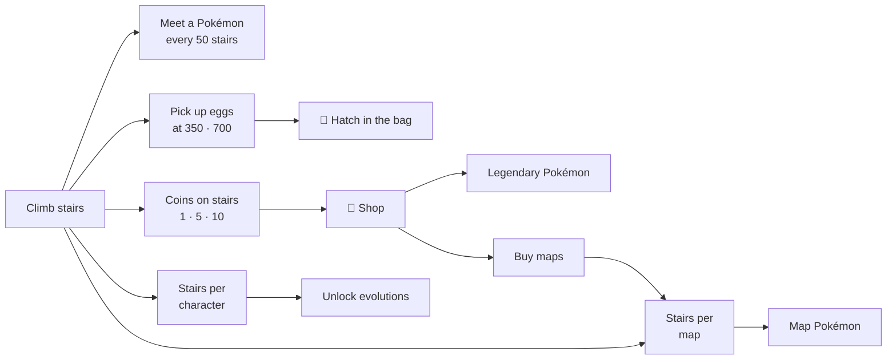

# Pokemon Stairs (포캣몬 계단) v1.0

**English** | [한국어](README_KR.md)

A mobile-first casual web game: read where the stairs go and keep climbing forever.
It follows the *Infinite Stairs* formula (two buttons: **Climb / Turn**) and adds Pokémon collecting, evolution, egg hatching, coins, a shop, and buyable maps.

> The whole game is **a single HTML file** (`index.html`) with no build step and no external libraries.
> Just open it in a browser to play.

<p align="center">
  
  
  
</p>

## Features

| Area | What it does |
|---|---|
| 🎮 Core play | Climb / Turn, a timer gauge that drains faster the higher you go, game over by falling or running out of time |
| 🐾 80 characters | All drawn in Canvas code, with a front view (standing) and a side view (running). Two-legged and four-legged runs, flying, rolling, and more |
| 🔼 Stair encounters | A Pokémon waits every 50 stairs (Charmander at 50 → … → Mew at 350) |
| ✨ Evolution | 500 stairs climbed with a base form unlocks its 1st evolution, then 1,000 stairs with the 1st evolution unlocks the 2nd (each evolution is a new character) |
| 🥚 Eggs | A green-spotted egg on stair 350 and a yellow-spotted egg on stair 700, hatched from the item bag |
| 🪙 Coins | Each stair has a 50% chance of a 1, 5, or 10 coin. Each player's total is saved |
| 🛒 Shop | Buy legendary Pokémon (Articuno, Zapdos, Moltres, Mewtwo) and maps (Jungle, Desert, Sea) |
| 🗺️ Map Pokémon | Climb 3,000 / 5,000 / 10,000 stairs on a map to earn that map's Pokémon |
| 👥 Players & ranking | Several local players per device, separate records, and an overall ranking that shows the character used for each best score |
| 🌐 Languages | Korean / English toggle, including Pokémon names |
| 📱 Mobile | Scales to screen size and pixel ratio, touch buttons, safe-area support, no accidental zoom or scroll |

## Getting started

```sh
git clone <this-repo>
cd <this-repo>
open index.html          # macOS (Windows: start index.html / Linux: xdg-open index.html)
```

- No server needed. Just open `index.html` in a browser.
- To play on a phone, publish it with GitHub Pages (repository Settings → Pages → `main` branch, root folder).

## Controls

| Action | Keyboard | Mobile |
|---|---|---|
| Climb (one step in the direction you face) | `→` / `D` / `Space` | Bottom-right button |
| Turn (switch direction, then step) | `←` / `A` | Bottom-left button |
| Start from the menu | `Space` / `Enter` | Start button |
| Change character in the menu | `←` / `→` | Tap an icon |
| Close a window | `Esc` | Close button / tap outside |

You fall if there is no stair where you step. The game also ends when the timer gauge reaches zero.

## Progression at a glance



| How to get it | Pokémon |
|---|---|
| From the start | Pichu |
| Stairs (50–350) | Charmander, Squirtle, Bulbasaur, Cyndaquil, Chikorita, Totodile, Mew |
| Green-spotted egg (65% chance of nothing) | Cleffa, Igglybuff, Dunsparce, Wimpod, Smoochum, Tadbulb, Larvesta |
| Yellow-spotted egg (always hatches) | Fidough, Munchlax, Sizzlipede, Indeedee, Snom, Ekans |
| Shop | Articuno · Zapdos · Moltres (30,000 coins each), Mewtwo (100,000 coins) |
| Desert map | Geodude, Swinub, Trapinch |
| Jungle map | Bellsprout, Hoppip, Treecko |
| Sea map | Poliwag, Horsea, Spheal |
| Evolution | The 1st and 2nd evolutions of the Pokémon above |

The full list, odds, and evolution rules are in [`spec.md`](spec.md).

## Saved data

- All progress is stored **per player** in the browser's `localStorage` (key prefix `pikachuStairs.`).
- There is no server or account, so **progress is not shared between devices or browsers.**
- Clearing the browser's site data also clears the game's progress.

## Project layout

```
.
├── index.html            # The whole game (HTML + CSS + JS, about 7,300 lines)
├── docs/screenshots/     # Screenshots for this README
├── README.md             # Introduction (English, this file)
├── README_KR.md          # Introduction (Korean)
├── ARCHITECTURE.md       # Code structure and design (English)
├── ARCHITECTURE_KR.md    # Code structure and design (Korean)
├── spec.md               # Feature spec, development log, decisions (English)
├── spec_KR.md            # Feature spec (Korean)
└── CLAUDE.md             # Working rules for the AI coding assistant (Claude Code), in Korean
```

## Documentation

- [`ARCHITECTURE.md`](ARCHITECTURE.md) / [`ARCHITECTURE_KR.md`](ARCHITECTURE_KR.md): code structure, game loop, data model, how to extend the game
- [`spec.md`](spec.md) / [`spec_KR.md`](spec_KR.md): detailed spec of every feature and the development log
- [`CLAUDE.md`](CLAUDE.md): rules and test methods for working in this repository (Korean)

## Development notes

- There is no build step. Edit `index.html` and reload the browser.
- Syntax check: extract the script and run `node --check` on it.
- Visual check: auto-play in headless Chrome and take screenshots (see `CLAUDE.md`).

## Credits and notice

- **Pokemon Stairs v1.0** developed by **JS Daniel Han** (2026.10.04)
- Built with [Claude Code](https://claude.com/claude-code).
- This is an **unofficial, non-commercial fan game** made for personal and learning purposes.
  Pokémon and Pokémon character names are trademarks of Nintendo, Creatures Inc., and GAME FREAK inc.
  No official artwork is used. Every character in the game is drawn with Canvas code.
- License: not decided yet.
